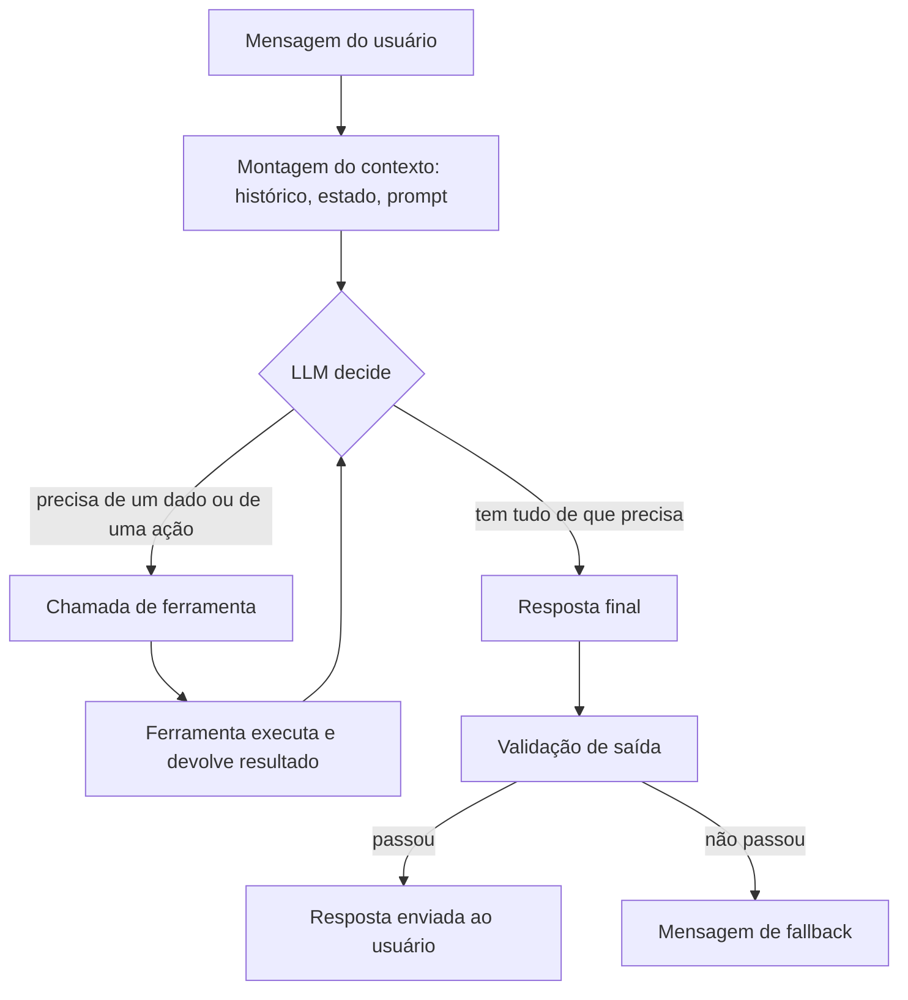
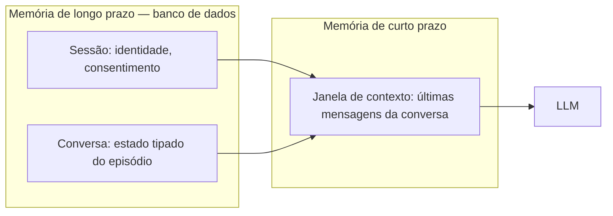
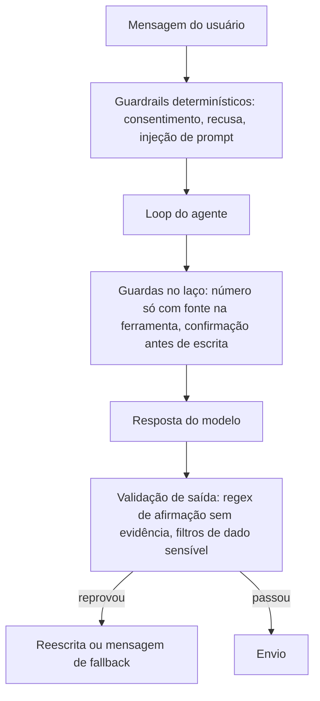
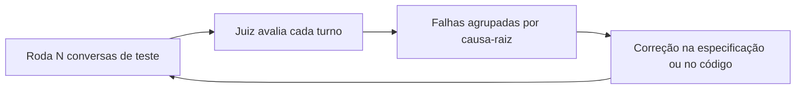

No post anterior, contei a trajetória: como saí do zero até trabalhar com agentes de *IA* em dois projetos reais ao longo do ano. Mas ficou uma lacuna — eu narrei a jornada, e não a máquina. Neste post eu abro o capô: o que acontece entre uma mensagem chegar e uma resposta sair, as mãos que o agente usa para agir, a memória que o faz lembrar e as cercas que o impedem de inventar. Aperte os cintos para mais uma viagem pelo ciberespaço!

### Um modelo não é um agente

Um *LLM* sozinho é só uma conversa: ele lê texto e devolve texto, sem memória de nada que veio antes da janela atual e sem conseguir mexer em nada no mundo real. Você pode perguntar "e meus pedidos?", e ele vai responder com muito boa vontade — inventando tudo, porque ele não tem de onde tirar.

Agente é o que acontece quando você coloca o modelo dentro de um sistema: um *loop* que roda a cada mensagem, ferramentas que ele pode chamar para buscar e alterar dados de verdade, e um estado guardado fora da cabeça dele. A separação de papéis é essa: **o modelo decide o próximo passo; o resto do sistema decide o que ele pode fazer**.

### O ciclo: decidir, agir, repetir

O coração de um agente é um laço. A cada turno, o sistema monta o contexto (o histórico da conversa, o estado atual, o *prompt* de sistema) e entrega ao modelo. O modelo responde de dois jeitos possíveis: ou escreve a resposta final para o usuário, ou pede uma chamada de ferramenta. Se pediu ferramenta, o sistema executa, devolve o resultado para dentro do contexto e o ciclo recomeça — até o modelo ter tudo de que precisa para responder.

O detalhe que todo mundo esquece: esse laço tem freio. Teto de iterações, *timeout* global, e a mesma ferramenta que devolve a mesma resposta não fica em cena para sempre — sem isso, um modelo indeciso roda em círculo até a falência (e a fatura). A disciplina de limitar o laço é o que separa um agente de um foguete sem controle.

### As mãos: ferramentas com contrato

Ferramenta é a unidade de *API* do agente. No meu trabalho, a fronteira entre o "cérebro" e o mundo exterior é o *MCP* (*Model Context Protocol*), mas a mecânica vale para qualquer *function calling*: cada ferramenta tem um nome, uma descrição em linguagem natural — é isso que o modelo lê para decidir quando usá-la — e um *schema* tipado que valida cada parâmetro. O modelo não manda texto livre: manda argumentos que o contrato aceita ou rejeita.

As categorias que todo agente conversacional acaba tendo: ferramentas de leitura (identificar o usuário, buscar catálogo, consultar disponibilidade), ferramentas de escrita (criar ou alterar algo — que pedem confirmação humana antes de executar) e ferramentas utilitárias (validações que precisam rodar *antes* de uma ação destrutiva). E os erros também são contrato: quando uma ferramenta falha, o que volta para o modelo é um texto estruturado que ele consegue interpretar e comunicar — nunca uma exceção crua.

A lição que mais aprendi no assunto: ferramenta genérica demais (aquele *query* de *SQL* cru que parece conveniente) é convite à tragédia. Quanto mais semântica e estreita a ferramenta, mais previsível o agente. O contrato estável por cima da complexidade é o que permite trocar o sistema por trás sem reescrever nada do agente.

### Duas línguas, um mesmo laço

Para quem acompanhou o post anterior, um detalhe rendeu comparação direta: os dois projetos de agente que vivi foram construídos em línguas diferentes — um em *TypeScript*, outro em *Python*. E a comparação é instrutiva justamente porque, por baixo de tudo, o laço é o mesmo.

No lado *TypeScript*, o encanamento do modelo veio do [*LangChain*](https://github.com/langchain-ai/langchainjs). E o nome dele merece uma explicação honesta, porque a fama de *framework* de tudo faz parecer magia — e não é. O *LangChain* é três conveniências bem feitas: uma interface única para qualquer provedor de modelo (trocar provedor virou trocar uma *factory*, sem tocar no resto), o formato padronizado das mensagens (de sistema, de usuário, de ferramenta) e o `bindTools`, que apresenta as ferramentas com contrato ao modelo na hora da chamada. O *loop* agêntico em si — invocar o modelo, rotear *tool calls*, aplicar limites e guardar auditoria — foi escrito à mão, como serviço nosso. Mais código para manter, e controle total sobre cada passo.

No lado *Python*, o [*LangGraph*](https://github.com/langchain-ai/langgraph) sobe um degrau de abstração: em vez de você escrever o laço, modela-se o agente como um **grafo de estados**. Nós são etapas (receber, rotear, agir, responder), arestas são as transições entre elas, e o estado que atravessa o grafo é tipado de ponta a ponta com *Pydantic*, que valida em tempo de execução. A consequência prática é bonita: o roteador determinístico que mencionei nas cercas deixa de ser código espalhado e vira estrutura do grafo — a rota entre "compliance" e "vendedor" é uma aresta, desenhada no papel antes de existir no código.

E o resto é ecossistema. *Python* carrega o ecossistema de *IA* mais maduro — *Pydantic*, *embeddings*, *notebooks*, documentação das bibliotecas de modelo chegando primeiro. *TypeScript* carrega a vantagem de falar a língua do resto do *stack*: o agente compartilha linguagem, *tooling* e times com o *backend* *web*, e os *schemas* saem do *Zod*, com o compilador pegando o erro antes de rodar qualquer coisa. Não existe vencedor absoluto aqui: existe o que casa com o time e com o sistema em volta. E como eu já preguei no estudo, **a ferramenta é só detalhe — o que importa é o ciclo: decidir, agir, conferir, repetir**.

### A memória: o que o modelo lembra e o que o sistema lembra

A janela de contexto do modelo é a memória de curto prazo — e ela é pequena e cara. O que a conversa inteira precisa saber mora em banco: identidade do usuário e consentimento (que nem deveriam expirar), o episódio da conversa em si (com prazo de validade), e o turno corrente (que vive e morre dentro dele mesmo).

Dois hábitos valem ouro aqui. O primeiro: persistir cada resultado de ferramenta como mensagem da conversa — além de dar ao modelo contexto entre turnos, isso cria uma trilha de auditoria do raciocínio completo, da pergunta do usuário à resposta final. O segundo: gravar o estado **antes** de enviar a resposta no canal. O inverso deixa o cliente olhando para uma fala que o agente "não lembra" de ter dito — e conversa sem memória confiável é conversa que não convence ninguém.

### Cercas antes de liberdade: guardrails

Aqui mora a filosofia que mais me pegou nesses projetos: **o modelo decide o texto, nunca os fatos**. Toda proteção acontece em três momentos — antes do modelo, dentro do laço e depois do modelo.

Antes do modelo, tudo que é determinístico roda em código puro: consentimento, pedido de saída, tentativa de injeção de *prompt* — nada disso é assunto para *LLM*. Dentro do laço, a regra de ouro é número sem fonte não existe: preço, prazo e total só podem ser falados se vierem de ferramenta, e o agente jamais calcula — a conta vem do sistema, não da matemática inventada do modelo. Depois do modelo, validadores baratos e determinísticos (uma *regex* bem feita custa nada e pega o pior caso) conferem a saída, e falha reprovada vira reescrita — na segunda vez, o texto sai montado por código.

Não vou mentir que foi só glória aprender isso: o erro vira dado. Modelo que afirma "resolvido" sem ter chamado ferramenta nenhuma é padrão clássico de alucinação, e *regex* de padrões proibidos na saída é defesa mais confiável que qualquer instrução no *prompt*. A instrução educa; o código cerca.

### Como saber se ele funciona

Aqui está a parte que mais mudou meu jeito de testar software. *LLM* é probabilístico: a mesma conversa roda dez vezes e sai dez versões diferentes. "Passou uma vez" não significa nada — **qualidade de agente é taxa, não amostra**.

A avaliação em camadas respeita o custo: o que é grátis roda sempre (contratos, *regex* na resposta, decisão de ferramenta sem executá-la); o que paga chave roda com critério (conversas de ouro inteiras avaliadas por *LLM*-como-juiz, com régua escrita e gabarito — porque juiz também erra e precisa ser auditado); e de vez em quando a caixa-preta: um cliente simulado de verdade conversando com o agente por fora, sem olhar o código, com placar por checagem e rodadas suficientes para a estatística dizer algo.

E o laço é o mesmo do desenvolvimento: onda de teste mede, falhas se agrupam por causa, correção entra, e a onda seguinte re-mede os mesmos cenários para provar a correção em taxa. Uma confissão honesta: as conversas de ouro envelhecem — toda vez que uma premissa de comportamento muda, os *transcripts* pedem atualização. Teste de agente não é coisa que se constrói uma vez; é coisa que se cultiva.

### O que sobrou

Se eu tivesse que resumir tudo que os dois projetos me ensinaram sobre a máquina: o modelo é o candidato a estrela, mas quem faz o agente funcionar é o time de bastidores — contratos de ferramenta, estado em banco, guardrails determinísticos e avaliação contínua. Modelagem de *prompt* é a parte visível do *iceberg*; o resto é engenharia de software dos anos de sempre, com *retry*, *idempotência* e trilha de auditoria.

E mais uma vez, a mesma lição de propósito: nenhuma dessas cercas existe para amarrar o agente, existe para deixar a autonomia dele confiável — para quem conversa com ele e para quem responde por ele. No fim, agente de *IA* é como qualquer outro sistema: perde o propósito se não tiver ninguém dos dois lados da conversa, lembre-se disso!

No mais, fiquem com os links:

 - [Model Context Protocol — a especificação do MCP](https://modelcontextprotocol.io)
 - [LangChain — a camada de encanamento do modelo](https://github.com/langchain-ai/langchainjs)
 - [LangGraph — grafos de estado para agentes](https://github.com/langchain-ai/langgraph)
 - [Langfuse — o tracing de conversas](https://github.com/langfuse/langfuse)
 - [Light SDD Workflow — o estudo que documentei](https://github.com/VictorHugoBatista/light-sdd-workflow)
 - [Gist — minha primeira pesquisa de IA](https://gist.github.com/VictorHugoBatista/cdd6a0eb842cac40362d03e0fea3a613)